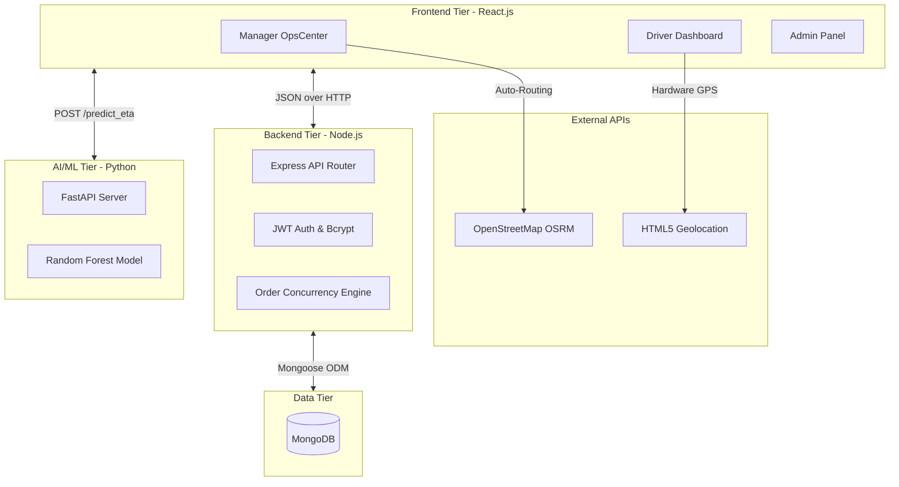

# AI Logistics & Delivery Automation Platform
**Comprehensive System Architecture & Developer Documentation**

---

## 1. Project Overview & Vision
This project is an enterprise-grade, microservice-based logistics platform. It automates the delivery dispatch process by combining real-time gig-economy features (like Uber/Swiggy) with Machine Learning to predict delivery ETAs and flag potential delays before they happen.

---

## 2. System Architecture

The platform operates on a **3-Tier Microservice Architecture**. 



### Technology Stack Breakdown:
* **Frontend:** React.js, TailwindCSS, Vite, React-Leaflet (for maps), Lucide-React (icons).
* **Backend:** Node.js, Express.js.
* **Database:** MongoDB, Mongoose ODM.
* **Security:** JSON Web Tokens (JWT) for session management, Bcrypt for password hashing.
* **AI Engine:** Python, Pandas, Scikit-Learn (Random Forest Regressor), FastAPI, Uvicorn.
* **External Integrations:** OpenStreetMap (OSRM) for route distance calculation, HTML5 Geolocation API for hardware GPS tracking.

---

## 3. The Lifecycle of an Order (How Data Flows)

Understanding this workflow is crucial for explaining the project. Here is exactly what happens when a delivery occurs:

1. **Order Creation (Manager):** 
   * The Manager selects a *Pickup Zone* and *Drop-off Zone*.
   * **The Magic:** The React app instantly pings the OpenStreetMap (OSRM) routing API. It takes the GPS coordinates of those two zones and calculates the exact physical driving distance in kilometers.
2. **AI Prediction:**
   * React sends this distance, along with the Weather and Traffic levels, to the **Python FastAPI Microservice**.
   * The Random Forest model looks at 50,000 historical deliveries and predicts the ETA in minutes.
   * If the ETA is > 40 minutes, the order is flagged as a "Predicted Delay".
3. **Database Insertion:**
   * The order is saved to MongoDB via the Node.js API with a status of `Pending`.
4. **Gig-Economy Broadcast:**
   * All online drivers constantly poll the database for `Pending` orders. The new order pops up on all their screens simultaneously.
5. **Concurrency Claim (The Race):**
   * A driver clicks "Accept Order". The Node.js server uses a locking mechanism: it assigns the `driver_id` to the order and changes the status to `Active`. If another driver clicks accept a millisecond later, the server blocks them.
6. **Live GPS Tracking:**
   * The Driver app accesses the phone's physical GPS chip using `navigator.geolocation`.
   * It sends the driver's exact coordinates to MongoDB every few seconds.
   * The Manager's Leaflet map automatically pulls these coordinates, making the blue pin physically move across the screen.
7. **Delivery Lifecycle:**
   * The driver clicks **"Confirm Picked Up"** -> The UI switches modes, and the AI calculates the final countdown ETA to the customer.
   * The driver clicks **"Mark as Delivered"** -> The database status changes to `Delivered`, clearing the driver's screen so they can accept a new gig.

---

## 4. Core Modules & Features Detail

### A. The AI Machine Learning Module
* **How it works:** We trained a `RandomForestRegressor` on a 50,000-row CSV dataset (localized to Bengaluru). 
* **Inputs:** `distance_km`, `weather`, `traffic_level`, `restaurant_prep_time`, `driver_experience`.
* **Output:** `predicted_eta_minutes`.
* **Why it's smart:** Unlike Google Maps, which uses road speed limits, this model uses *historical pattern recognition*. It knows that 5km in "Rain" + "High Traffic" takes significantly longer than 5km in "Clear" + "Low Traffic".

### B. Manager OpsCenter (The Dispatch Hub)
* **Real-Time KPIs:** Calculates active deliveries and counts how many are mathematically predicted to be delayed.
* **React-Leaflet Map:** Renders an interactive map of Bengaluru. It filters the MongoDB database for online drivers and plots their live coordinates.
* **Hybrid Auto-Routing:** Replaces manual distance typing with a dynamic Zone-to-Zone API call (OpenStreetMap) to prevent human error during dispatch.

### C. Driver Dashboard (Gig-Economy App)
* **Hardware Interfacing:** Uses browser-level hardware APIs to read the device's physical GPS location.
* **State-Machine UI:** The interface is built as a dynamic state machine with three rigid phases:
  1. *Listening:* Displaying the broadcast pool.
  2. *Active:* Navigating to the restaurant.
  3. *Picked Up:* Navigating to the customer (triggers the AI ETA display).

### D. System Admin Panel
* **Dynamic Provisioning:** Allows root admins to create new employee accounts directly into MongoDB.
* **Security Middleware:** Passwords created here are immediately intercepted by a Mongoose `pre('save')` hook and hashed via Bcrypt before entering the database, ensuring absolute security.

---

## 5. Database Schema

### `User` Collection
* `name`, `email`
* `password` (Encrypted string via Bcrypt)
* `role` (Admin, Manager, Driver)
* `vehicleId`
* `location` (Object containing `lat`, `lng`, and `updatedAt` for live tracking)

### `Order` Collection
* `order_id` (Unique identifier)
* `pickup_area`, `delivery_area`
* `distance_km`, `weather`, `traffic_level`
* `status` (Enum: `Pending`, `Active`, `Picked_Up`, `Delivered`)
* `late_delivery` (Boolean flag determined by the AI)
* `driver_id` (Relational link to the User collection)

---

## 6. How to Run the Project (For Vivas/Demos)

You must run all three microservices simultaneously in three separate terminal windows:

**Terminal 1 (Backend Node.js):**
```bash
cd backend
npm install
npm run dev
# Runs on http://localhost:5000
```

**Terminal 2 (AI FastAPI Python):**
```bash
cd ai_engine
pip install fastapi uvicorn pandas scikit-learn
uvicorn main:app --host 0.0.0.0 --port 8000
# Runs on http://localhost:8000
```

**Terminal 3 (React Frontend):**
```bash
cd frontend
npm install
npm run dev
# Runs on http://localhost:5173
```
