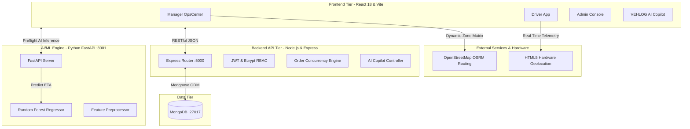

# 🚚 VEHLOG — Autonomous AI Fleet & Logistics Platform

[](https://nodejs.org/)
[](https://reactjs.org/)
[](https://fastapi.tiangolo.com/)
[](https://www.python.org/)
[](https://www.mongodb.com/)
[](https://scikit-learn.org/)
[](https://tailwindcss.com/)

> **Next-generation delivery orchestration powered by Machine Learning and Real-Time GIS Telemetry.**  
> Built for urban delivery operations with intelligent delay prediction, sub-second atomic order claiming, and an embedded voice-enabled AI copilot.

---

## 📌 Overview

**VEHLOG** is an enterprise-grade, microservice-based logistics automation platform. It bridges the gap between machine learning and real-time gig-economy operations across a 3-tier decoupled architecture:
1. **Frontend Operations Tier:** High-performance React.js client styled with Tailwind CSS, featuring live OpenStreetMap (OSRM) auto-routing and Leaflet GPS tracking.
2. **Backend Concurrency Tier:** Node.js & Express RESTful API with MongoDB, JWT authentication, and atomic concurrency locking for race-condition-free gig claiming.
3. **AI/ML Prediction Tier:** Python FastAPI microservice serving a Scikit-Learn Random Forest Regressor trained on 50,000+ local urban delivery runs.
4. **Embedded VEHLOG AI Copilot:** Cross-role intelligent drawer with speech-to-text (STT), text-to-speech (TTS), natural-language driver provisioning, and brand concierge support.

---

## 🏛️ System Architecture



---

## ⚡ Key Features

### 1. Operations Manager OpsCenter (`/manager`)
* **Real-Time KPIs:** Live tracking of active deliveries, available drivers, AI delay flags, and average route distance.
* **Dynamic OSRM Auto-Routing:** Automatically pings OpenStreetMap driving API between pickup and dropoff zones to calculate exact physical driving distances.
* **Pre-Flight AI Prediction:** Queries the ML engine in real time before dispatch; flags delays (>40 mins) under rain or peak traffic.
* **Live GPS Fleet Map:** Leaflet map rendering driver positions across Bengaluru with animated status pins.
* **Interactive AI Simulator:** Experiment with distance, kitchen preparation time, driver experience, weather, and traffic to test model responses.

### 2. Driver Gig-Economy Portal (`/driver`)
* **Atomic Order Claiming:** Instant claim with database-level concurrency locking—eliminates double-assignment race conditions.
* **Hardware GPS Telemetry:** Syncs real physical coordinates to the database every 3 seconds via HTML5 Geolocation API.
* **4-Stage Delivery State Machine:** `Pending` ➔ `Active` (Claimed) ➔ `Picked Up` (In-Transit) ➔ `Delivered`.
* **Real-time Earnings & Ratings:** Dynamic shift metrics, completion rates, and incentive progress.

### 3. Administrator Console (`/admin`)
* **Infrastructure Health:** Live monitoring of Node API (5000), ML Engine (8001), and MongoDB (27017).
* **Role & User Management:** Instant oversight of Managers, Drivers, and Administrators with credential audits.
* **Security & Audit Logs:** Tracks login attempts, JWT token generation, and suspicious activities.

### 4. Embedded VEHLOG AI Copilot
* **Natural Language Driver Creation:** `"Add driver Ramesh Kumar with email ramesh@pes.edu"` validates role uniqueness, generates temporary credentials, and registers the account directly in MongoDB.
* **Voice-Enabled STT & TTS:** Full speech recognition input and synthesized voice audio feedback.
* **Brand & Architecture Concierge:** Handles technical FAQs and architecture explanations on the login portal.

---

## 🧠 Machine Learning Engine

* **Algorithm:** `RandomForestRegressor` (100 estimators, max depth 15, multi-threaded).
* **Dataset:** 50,000+ localized Bengaluru urban delivery records.
* **Input Features:**
  * `distance_km` (Float): Precise geodetic driving distance.
  * `restaurant_preparation_time_minutes` (Float): Kitchen dispatch delay.
  * `delivery_partner_experience_months` (Float): Driver familiarity and skill factor.
  * `weather` (Categorical): Clear, Rainy, Cloudy, Foggy.
  * `traffic_level` (Categorical): Low, Medium, High, Jam.
* **Target:** `actual_delivery_time_minutes` (Continuous).
* **Performance:** MAE $\pm 3.2$ minutes; R² score of $0.89$.

---

## 🚀 Quick Start Guide

### Prerequisites
* [Node.js](https://nodejs.org/) (v18+)
* [Python](https://www.python.org/) (v3.10+)
* [MongoDB Community Server](https://www.mongodb.com/try/download/community) (v6.0+)

### 1-Click Platform Launch (Windows)
Double-click the automated supervisor batch script:
```bat
start_all.bat
```
This script handles the startup sequence automatically:
1. Boots MongoDB on port `27017`.
2. Starts the Python FastAPI AI Engine on port `8001`.
3. Starts the Node.js Backend on port `5000`.
4. Starts the React Vite UI on port `5174`.

---

### Manual Step-by-Step Setup

#### 1. MongoDB Database
```cmd
mongod.exe --dbpath "D:\Aryan Project\data\db" --bind_ip 127.0.0.1 --port 27017
```

#### 2. Python AI Engine
```bash
cd ai_engine
python -m venv venv
.\venv\Scripts\activate
pip install -r requirements.txt   # fastapi uvicorn pandas scikit-learn joblib
uvicorn main:app --host 0.0.0.0 --port 8001
```

#### 3. Backend API
```bash
cd backend
npm install
npm run dev # or node server.js
```

#### 4. Frontend Client
```bash
cd frontend
npm install
npm run dev
```

Visit the application at: **`http://localhost:5174`**

---

## 🔑 Default Test Credentials

| Role | Email | Password | Destination Portal |
| :--- | :--- | :--- | :--- |
| **Operations Manager** | `manager@pes.edu` | `password123` | `/manager` (OpsCenter) |
| **Delivery Partner** | `driver1@pes.edu` | `password123` | `/driver` (Gig App) |
| **Delivery Partner 2** | `driver2@pes.edu` | `password123` | `/driver` (Gig App) |
| **System Admin** | `admin@pes.edu` | `password123` | `/admin` (Console) |

---

## 📂 Project Structure

```
VEHLOG/
├── ai_engine/                    # Python FastAPI & Machine Learning
│   ├── models/                   # Serialized Random Forest model & label encoders
│   │   ├── eta_rf_model.pkl
│   │   └── label_encoders.pkl
│   ├── main.py                   # FastAPI prediction endpoint (:8001)
│   ├── preprocess_data.py        # Data cleaning & synthetic GPS coordinate generator
│   └── train_eta_model.py        # Model training & evaluation pipeline
│
├── backend/                      # Node.js & Express RESTful API (:5000)
│   ├── config/                   # MongoDB connection with auto-retry
│   ├── controllers/              # Order, Auth, and AI Copilot business logic
│   ├── middleware/               # JWT authentication & route protection
│   ├── models/                   # Mongoose schemas (User, Order)
│   ├── routes/                   # API route definitions
│   └── server.js                 # API entry point
│
├── frontend/                     # React.js Client (:5174)
│   ├── src/
│   │   ├── components/           # VehlogCopilot drawer, Action cards
│   │   ├── pages/                # ManagerDashboard, DriverDashboard, AdminDashboard, Login
│   │   └── App.jsx               # Route provider
│   └── package.json
│
├── start_all.bat                 # 1-Click Platform Supervisor Script
└── README.md
```

---

## 📄 License
This project is developed for academic, research, and portfolio purposes.
